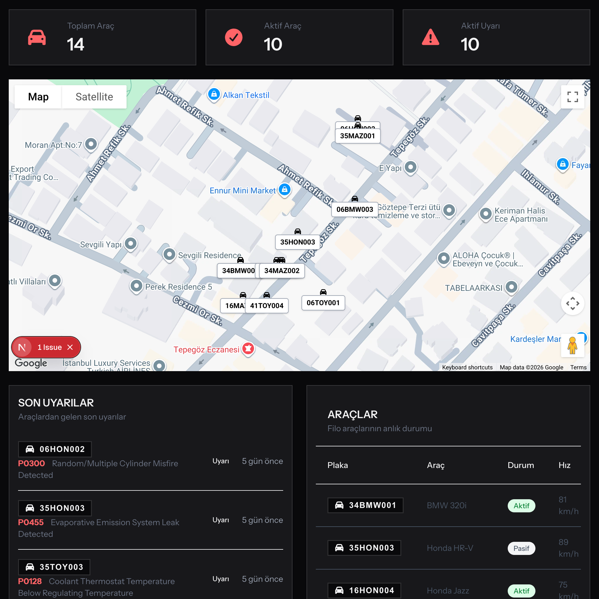
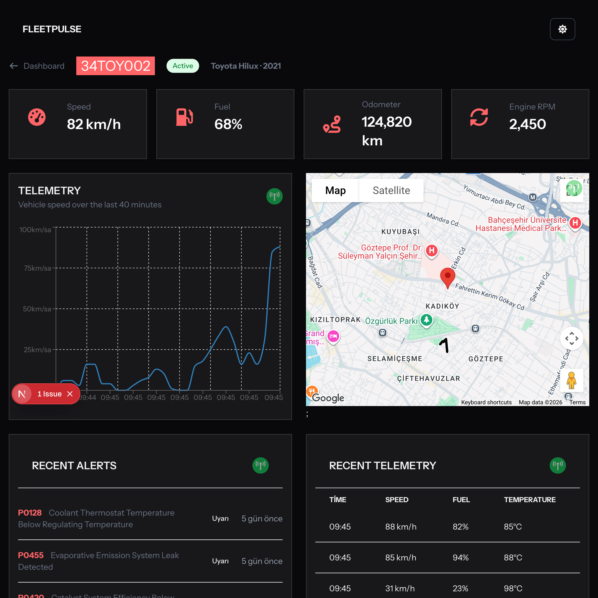
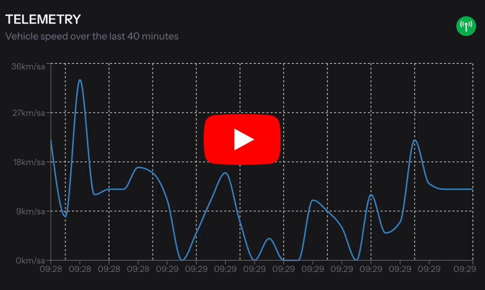
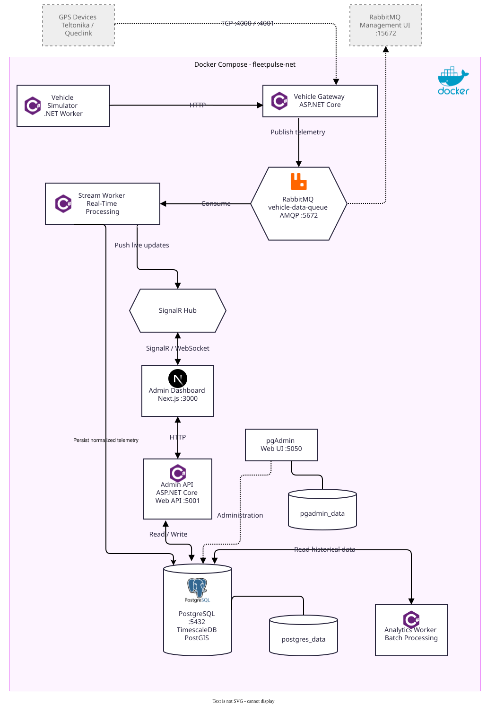

# FleetPulse

### Distributed Vehicle Telemetry Processing Platform

FleetPulse is a .NET 10 microservices-based platform for ingesting, processing, normalizing, and analyzing vehicle telemetry from different manufacturers.

The project demonstrates distributed systems concepts through asynchronous messaging, manufacturer-specific parsing, real-time updates, persistent storage, and background analytics.

<p align="center">
  
  
</p>

[](https://www.youtube.com/watch?v=bAA6xZj2KZc)

## Architecture



### Quick Start

**Prerequisites**

- Docker Desktop with Docker Compose
- Git

**Run the application**

```bash
git clone https://github.com/serdargulum/FleetPulse
cd FleetPulse  
  
# Create a .env file in the project root using .env.test as a reference.
docker compose up --build
```

Wait for the services to initialize. Database readiness and service startup times may vary.

The development environment uses Docker Compose to run the application services and supporting infrastructure.

### Demo Flow

1. Start the environment and initialize the services.
2. Generate synthetic vehicle telemetry using the Vehicle Simulator.
3. Follow the ingestion and asynchronous processing pipeline.
4. Inspect vehicle data and real-time updates in the dashboard.
5. Explore persisted telemetry and the Analytics Worker.

*The available demo flow depends on the services and features enabled in the current configuration.*

### Management Interfaces

**RabbitMQ Management**

```text
http://localhost:15672
```

**pgAdmin**

```text
http://localhost:5050
```

Use the development credentials configured in your local  `.env` file

## Core Design Decisions

### 1. Fast Ingestion, Asynchronous Processing

The Vehicle Gateway accepts telemetry over HTTP and publishes incoming messages to RabbitMQ. The Stream Worker handles parsing, normalization, validation, persistence, and real-time processing asynchronously.

```text
HTTP Request → Vehicle Gateway → RabbitMQ → Stream Worker
```

This separates ingestion from downstream processing, allowing the system to absorb processing backlogs without requiring the Gateway to perform every operation synchronously.

### 2. Preserve Raw Payloads

Different manufacturers expose different payload structures. The Gateway forwards raw telemetry rather than converting every payload into a shared DTO.

```text
Manufacturer JSON → RabbitMQ → Stream Worker → UnifiedTelemetryDto
```

This keeps manufacturer-specific parsing concerns out of the ingestion layer.

### 3. Manufacturer-Specific Parsers

The Stream Worker uses `IVehicleDataParser` to isolate differences between manufacturer payloads.

```csharp
public interface IVehicleDataParser
{
    string VehicleType { get; }
    UnifiedTelemetryDto Generate(JsonElement data);
}
```

Current parser implementations:

- BMW — `BmwVehiclePayload`
- Honda — `HondaVehiclePayload`
- Mazda — `MazdaVehiclePayload`
- Toyota — `ToyotaVehiclePayload`

Each parser converts its supported payload format into a normalized telemetry model.

### 4. Vehicle-Based Parser Resolution

The vehicle registry provides the manufacturer information used during parser resolution.

```text
Incoming Telemetry
       ↓
Vehicle Identifier
       ↓
Vehicles Table
       ↓
Brand / Model Metadata
       ↓
Parser Resolution
       ↓
UnifiedTelemetryDto
```

The vehicle registry acts as the source of truth for manufacturer information during telemetry processing.

### 5. Database Access and Schema Management

AdminApi manages PostgreSQL schema migrations using Entity Framework Core. StreamWorker uses direct SQL with Npgsql for telemetry persistence to minimize ORM overhead in the high-throughput ingestion path.

Given the limited number of data models and straightforward persistence requirements, direct SQL provides explicit query control without introducing unnecessary ORM complexity.

PostgreSQL extensions:

- **TimescaleDB** — `TelemetryRecords` is configured as a hypertable partitioned by `RecordedAt`. Time-based chunks are managed automatically, supporting efficient time-range queries as telemetry volume grows.
- **PostGIS** — Geographic coordinates are stored in a single `Location` column using the `geography(Point, 4326)` type, enabling spatial queries and distance calculations.

## Services

| Service | Responsibility | Communication |
|---|---|---|
| `vehicle-gateway` | Telemetry ingestion | HTTP / RabbitMQ |
| `stream-worker` | Real-time processing and normalization | RabbitMQ / PostgreSQL / SignalR (WebSocket/HTTP) |
| `analytics-worker` | Historical and batch analytics | PostgreSQL |
| `admin-dashboard` | Operational data and management UI | HTTP |
| `admin-api` | Management endpoints and database access | HTTP / PostgreSQL |
| `vehicle-simulator` | Synthetic telemetry generation | HTTP |
| `postgres` | Persistent data storage | TCP |
| `rabbitmq` | Asynchronous messaging | AMQP |
| `pgadmin` | Database administration | PostgreSQL / HTTP |

## Technology Stack

**Application:** C#, .NET 10, ASP.NET Core, Worker Services, SignalR, Entity Framework Core, Mediator

**Infrastructure:** PostgreSQL(TimescaleDB, PostGIS extensions), RabbitMQ, Docker, Docker Compose

**Architectural Patterns:** Microservices, Clean Architecture, Strategy Pattern, Repository Pattern, Dependency Injection, Asynchronous Messaging, Background Processing, Batch Processing

**Tools:** pgAdmin

## Project Status

FleetPulse is a portfolio project focused on demonstrating .NET, C#, distributed systems, and microservice architecture.

The current implementation provides the core ingestion → messaging → normalization → persistence pipeline, together with simulation, analytical processing, real-time updates, and administrative access.

The project is intentionally scoped as a technical showcase rather than a complete commercial fleet management product.


# Tests

### Running Integration Tests

Some integration tests require a running RabbitMQ instance.

Make sure Docker Compose services are running and the `.env` file contains the required RabbitMQ credentials.

On macOS or Linux, load the environment variables before running the tests:

```bash
set -a
source .env
set +a

dotnet test  
```

**Note:** The `.env` file is not automatically loaded into the environment of a `dotnet test` process. Keep your `.env` file out of version control and never commit credentials.

## License

This project is licensed under the [MIT License](LICENSE).